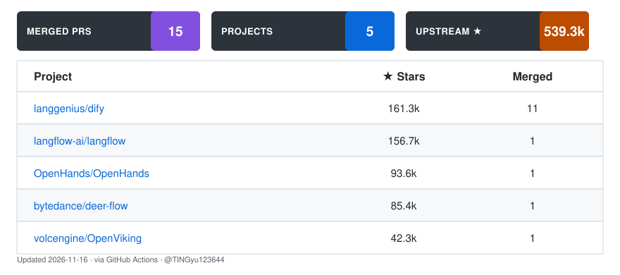

# TINGyu主人的贡献者仓库

### 在高星 AI / Agent 开源项目里，把 bug 修到上游

 

<table><tr>
<td align="center" width="55%">

</td>
<td align="center" width="45%">

</td>
</tr></table>

---

<!--START_SECTION:prs-->
## 🏆 已合并上游 PR（按仓库 star 数降序）

| # | 仓库 | PR | ⭐ Stars | 增 / 删 | 文件 | 含金量 |
|---|---|---|---|---|---|---|
| 1 | [**avelino/awesome-go**](https://github.com/avelino/awesome-go) | [#6904](https://github.com/avelino/awesome-go/pull/6904) — Remove 4 dead enetx links (organization no longer exists) |  |  /  | 1 | 📌 merged |
| 2 | [**ohmyzsh/ohmyzsh**](https://github.com/ohmyzsh/ohmyzsh) | [#14257](https://github.com/ohmyzsh/ohmyzsh/pull/14257) — docs(dotenv): fix dead 1Password Environments doc link |  |  /  | 1 | 📌 merged |
| 3 | [**langgenius/dify**](https://github.com/langgenius/dify) | [#46041](https://github.com/langgenius/dify/pull/46041) — test(api): add unit tests for libs.collection_utils |  |  /  | 1 | 📌 merged |
| 4 | [**langgenius/dify**](https://github.com/langgenius/dify) | [#46026](https://github.com/langgenius/dify/pull/46026) — test(api): pin PluginCredentialType API contract values |  |  /  | 1 | 📌 merged |
| 5 | [**langgenius/dify**](https://github.com/langgenius/dify) | [#45997](https://github.com/langgenius/dify/pull/45997) — test(api): add Pyrefly-clean unit tests for index entities |  |  /  | 1 | 📌 merged |
| 6 | [**langgenius/dify**](https://github.com/langgenius/dify) | [#45996](https://github.com/langgenius/dify/pull/45996) — test(api): add Pyrefly-clean unit tests for DocumentContext |  |  /  | 1 | 📌 merged |
| 7 | [**langgenius/dify**](https://github.com/langgenius/dify) | [#45262](https://github.com/langgenius/dify/pull/45262) — test(api): add unit tests for metadata filtering entities |  |  /  | 2 | 🧪 测试基建 |
| 8 | [**langgenius/dify**](https://github.com/langgenius/dify) | [#45261](https://github.com/langgenius/dify/pull/45261) — test(api): add unit tests for rag document models |  |  /  | 2 | 🧪 测试基建 |
| 9 | [**langgenius/dify**](https://github.com/langgenius/dify) | [#45256](https://github.com/langgenius/dify/pull/45256) — test(api): add unit tests for rag text splitter |  |  /  | 1 | 🧪 测试基建 |
| 10 | [**langgenius/dify**](https://github.com/langgenius/dify) | [#45255](https://github.com/langgenius/dify/pull/45255) — test(api): add unit tests for uuid_utils.is_valid_uuid |  |  /  | 1 | 🧪 测试基建 |
| 11 | [**langgenius/dify**](https://github.com/langgenius/dify) | [#45254](https://github.com/langgenius/dify/pull/45254) — test(api): add unit tests for remove_leading_symbols |  |  /  | 1 | 🧪 测试基建 |
| 12 | [**langgenius/dify**](https://github.com/langgenius/dify) | [#45225](https://github.com/langgenius/dify/pull/45225) — fix(libs): reject non-dict output in parse_and_check_json... |  |  /  | 2 | 🐛 真实 Bug |
| 13 | [**langgenius/dify**](https://github.com/langgenius/dify) | [#42997](https://github.com/langgenius/dify/pull/42997) — fix(api): preserve zero JSON-RPC request id in MCP error ... |  |  /  | 2 | 🐛 真实 Bug |
| 14 | [**langflow-ai/langflow**](https://github.com/langflow-ai/langflow) | [#15450](https://github.com/langflow-ai/langflow/pull/15450) — docs: document LANGFLOW_WORKFLOW_EXECUTION_TIMEOUT |  |  /  | 1 | 📌 merged |
| 15 | [**langflow-ai/langflow**](https://github.com/langflow-ai/langflow) | [#15411](https://github.com/langflow-ai/langflow/pull/15411) — fix(schema): sanitize underscore-prefixed field names in ... |  |  /  | 4 | 🏆 核心功能修复 |
| 16 | [**OpenHands/OpenHands**](https://github.com/OpenHands/OpenHands) | [#18922](https://github.com/OpenHands/OpenHands/pull/18922) — docs(helm): fix stale session-api-key.txt path in NOTES (... |  |  /  | 1 | 📌 merged |
| 17 | [**opencv/opencv**](https://github.com/opencv/opencv) | [#30956](https://github.com/opencv/opencv/pull/30956) — docs(py_setup): remove dead Enthought downloads link |  |  /  | 1 | 📌 merged |
| 18 | [**bytedance/deer-flow**](https://github.com/bytedance/deer-flow) | [#6361](https://github.com/bytedance/deer-flow/pull/6361) — fix(tests): skip MAX_PATH-exceeding blocking-io anchors o... |  |  /  | 3 | 🪟 跨平台兼容 |
| 19 | [**agno-agi/agno**](https://github.com/agno-agi/agno) | [#10599](https://github.com/agno-agi/agno/pull/10599) — fix: workflow preserve falsy step content (0, False, []) ... |  |  /  | 2 | 📌 merged |
| 20 | [**volcengine/OpenViking**](https://github.com/volcengine/OpenViking) | [#6387](https://github.com/volcengine/OpenViking/pull/6387) — fix(compile): keep the compile workspace root absolute (#... |  |  /  | 2 | 🐛 真实 Bug |
| 21 | [**gofiber/fiber**](https://github.com/gofiber/fiber) | [#4903](https://github.com/gofiber/fiber/pull/4903) — 📒 docs: remove dead CSRF recipe link |  |  /  | 1 | 📌 merged |
| 22 | [**agentscope-ai/agentscope**](https://github.com/agentscope-ai/agentscope) | [#4181](https://github.com/agentscope-ai/agentscope/pull/4181) — fix(security): enforce stdio MCP allowlist on from-librar... |  |  /  | 3 | 📌 merged |
| 23 | [**Tencent/teamai-cli**](https://github.com/Tencent/teamai-cli) | [#2074](https://github.com/Tencent/teamai-cli/pull/2074) — fix(import): route GitCode PR URLs to its provider, match... |  |  /  | 2 | 📌 merged |
| 24 | [**Tencent/teamai-cli**](https://github.com/Tencent/teamai-cli) | [#2068](https://github.com/Tencent/teamai-cli/pull/2068) — fix(knowledge): lock the shared worktree against concurre... |  |  /  | 4 | 📌 merged |

### 📖 每条 PR 在修什么

#### 📌 [#6904](https://github.com/avelino/awesome-go/pull/6904) · [avelino/awesome-go](https://github.com/avelino/awesome-go) — Remove 4 dead enetx links (organization no longer 
**合并者 maintainer · 2026-11-24 · +0 / −4 · 1 files**

---

#### 📌 [#14257](https://github.com/ohmyzsh/ohmyzsh/pull/14257) · [ohmyzsh/ohmyzsh](https://github.com/ohmyzsh/ohmyzsh) — docs(dotenv): fix dead 1Password Environments doc 
**合并者 maintainer · 2026-11-24 · +1 / −1 · 1 files**

---

#### 📌 [#46041](https://github.com/langgenius/dify/pull/46041) · [langgenius/dify](https://github.com/langgenius/dify) — test(api): add unit tests for libs.collection_util
**合并者 maintainer · 2026-11-11 · +91 / −0 · 1 files**

---

#### 📌 [#46026](https://github.com/langgenius/dify/pull/46026) · [langgenius/dify](https://github.com/langgenius/dify) — test(api): pin PluginCredentialType API contract v
**合并者 maintainer · 2026-11-12 · +89 / −0 · 1 files**

---

#### 📌 [#45997](https://github.com/langgenius/dify/pull/45997) · [langgenius/dify](https://github.com/langgenius/dify) — test(api): add Pyrefly-clean unit tests for index 
**合并者 maintainer · 2026-11-12 · +138 / −0 · 1 files**

---

#### 📌 [#45996](https://github.com/langgenius/dify/pull/45996) · [langgenius/dify](https://github.com/langgenius/dify) — test(api): add Pyrefly-clean unit tests for Docume
**合并者 maintainer · 2026-11-11 · +90 / −0 · 1 files**

---

#### 🧪 [#45262](https://github.com/langgenius/dify/pull/45262) · [langgenius/dify](https://github.com/langgenius/dify) — test(api): add unit tests for metadata filtering e
**合并者 @asukaminato0721 · 2026-11-08 · +105 / −0 · 2 files**

- RAG metadata filtering entities（`Condition` / `MetadataFilteringCondition`）此前无测试覆盖。
- 新增 35 个用例覆盖全部 19 个比较运算符、类型校验、逻辑组合和非法输入拒绝。
- 纯增量测试，不改生产代码；review 轮按 pyrefly strict 补了类型标注。

---

#### 🧪 [#45261](https://github.com/langgenius/dify/pull/45261) · [langgenius/dify](https://github.com/langgenius/dify) — test(api): add unit tests for rag document models
**合并者 @asukaminato0721 · 2026-11-05 · +226 / −0 · 2 files**

- RAG document models 的数据模型层此前测试覆盖薄弱。
- 新增 226 行单元测试，覆盖文档创建、分段、状态流转等核心模型方法。
- 纯增量测试，不改生产代码。

---

#### 🧪 [#45256](https://github.com/langgenius/dify/pull/45256) · [langgenius/dify](https://github.com/langgenius/dify) — test(api): add unit tests for rag text splitter
**合并者 @asukaminato0721 · 2026-11-09 · +115 / −0 · 1 files**

- RAG text splitter（`RecursiveCharacterTextSplitter`）此前测试覆盖不完整。
- 在原有 111 个用例基础上新增 19 个回归用例：正则分隔符保留/丢弃、chunk_overlap 共享词、超大 chunk 兜底、`split_documents` 元数据映射等。
- 纯增量 +114/-0；126 passed, 4 skipped（预存 tiktoken 可选跳过）。

---

#### 🧪 [#45255](https://github.com/langgenius/dify/pull/45255) · [langgenius/dify](https://github.com/langgenius/dify) — test(api): add unit tests for uuid_utils.is_valid_
**合并者 @wylswz · 2026-11-03 · +32 / −0 · 1 files**

- `api/core/tools/utils/uuid_utils.py` 的 `is_valid_uuid` 此前**零测试覆盖**。
- 新增 11 个参数化用例：规范连字符、大写、无连字符、带花括号、`urn:uuid:` 前缀 → 全部接受；`None`、空串、普通词、非十六进制字符 → 全部拒绝。
- 纯增量、不改生产代码；review 轮按 pyrefly `strict` preset 补了 `-> None` 返回类型标注。

---

#### 🧪 [#45254](https://github.com/langgenius/dify/pull/45254) · [langgenius/dify](https://github.com/langgenius/dify) — test(api): add unit tests for remove_leading_symbo
**合并者 @asukaminato0721 · 2026-11-04 · +59 / −0 · 1 files**

- `remove_leading_symbols` 工具函数此前无单元测试覆盖。
- 新增参数化用例覆盖：前导符号剥离、纯符号输入、混合符号+文字、边界空串等场景。
- 纯增量测试，不改生产代码。

---

#### 🐛 [#45225](https://github.com/langgenius/dify/pull/45225) · [langgenius/dify](https://github.com/langgenius/dify) — fix(libs): reject non-dict output in parse_and_che
**合并者 @Stream29 · 2026-11-05 · +19 / −0 · 2 files**

- `parse_and_check_json_markdown` 在模型返回非 dict 结构时，下游代码直接当 dict 取 key 会 `AttributeError`。
- 修复：解析后显式校验 `isinstance(result, dict)`，不满足直接抛异常，避免脏数据流入工具链。
- 新增对应回归测试用例。

---

#### 🐛 [#42997](https://github.com/langgenius/dify/pull/42997) · [langgenius/dify](https://github.com/langgenius/dify) — fix(api): preserve zero JSON-RPC request id in MCP
**合并者 @asukaminato0721 · 2026-11-09 · +16 / −1 · 2 files**

- JSON-RPC 2.0 规定 `id: 0` 是合法请求 id，但 `create_mcp_error_response` 用 `request_id or 1` 会把 0 变成 1，客户端永远匹配不上错误响应。
- 修复：改为 `request_id if request_id is not None else 1`，保留合法的 0 值。
- 新增零 id 回归测试。

---

#### 📌 [#15450](https://github.com/langflow-ai/langflow/pull/15450) · [langflow-ai/langflow](https://github.com/langflow-ai/langflow) — docs: document LANGFLOW_WORKFLOW_EXECUTION_TIMEOUT
**合并者 maintainer · 2026-11-16 · +1 / −0 · 1 files**

---

#### 🏆 [#15411](https://github.com/langflow-ai/langflow/pull/15411) · [langflow-ai/langflow](https://github.com/langflow-ai/langflow) — fix(schema): sanitize underscore-prefixed field na
**合并者 @erichare · 2026-09-28 · +264 / −11 · 4 files**

- JSON Schema 属性名允许以 `_` 开头，但 Pydantic 把前导下划线字段当私有属性，`create_model()` 直接抛 `NameError`；`update_tools()` 又把异常吞掉——用户看到的是 "Successfully loaded 0 tools"。
- 修复：剥离前导下划线构造安全字段名 → 确定性去重 → 原 wire 名通过 `AliasChoices` 保留；嵌套循环与顶层循环都覆盖。
- 本地复现：旧 HEAD 必抛 `NameError`，修复后模型构建、校验、`model_dump()` 往返全部通过。

---

#### 📌 [#18922](https://github.com/OpenHands/OpenHands/pull/18922) · [OpenHands/OpenHands](https://github.com/OpenHands/OpenHands) — docs(helm): fix stale session-api-key.txt path in 
**合并者 maintainer · 2026-11-16 · +1 / −1 · 1 files**

---

#### 📌 [#30956](https://github.com/opencv/opencv/pull/30956) · [opencv/opencv](https://github.com/opencv/opencv) — docs(py_setup): remove dead Enthought downloads li
**合并者 maintainer · 2026-11-19 · +1 / −1 · 1 files**

---

#### 🪟 [#6361](https://github.com/bytedance/deer-flow/pull/6361) · [bytedance/deer-flow](https://github.com/bytedance/deer-flow) — fix(tests): skip MAX_PATH-exceeding blocking-io an
**合并者 @WillemJiang · 2026-10-06 · +31 / −3 · 3 files**

- `backend/tests/blocking_io/` 下 12 个锚点在 Windows 上确定性地挂在 `OSError: [Errno 206] Filename too long`，突破了 260 字符 MAX_PATH。
- 给三个受影响文件加模块级 `pytest.mark.skipif(os.name == "nt")`，对齐项目已合并的 `#6257` / `#5931` 约定；POSIX 上照常跑。

---

#### 📌 [#10599](https://github.com/agno-agi/agno/pull/10599) · [agno-agi/agno](https://github.com/agno-agi/agno) — fix: workflow preserve falsy step content (0, Fals
**合并者 maintainer · 2026-11-20 · +70 / −2 · 2 files**

---

#### 🐛 [#6387](https://github.com/volcengine/OpenViking/pull/6387) · [volcengine/OpenViking](https://github.com/volcengine/OpenViking) — fix(compile): keep the compile workspace root abso
**合并者 @fujiajie666 · 2026-10-21 · +39 / −2 · 2 files**

- Docker 部署里 `storage.workspace` 配成相对路径时，每个 `ov compile` 任务在 `stage=sandbox` 直接报 `mkdir: cannot create directory`。
- 根因：`CompileSandboxManager` 把相对工作区根传进沙箱后端，凭证路径被相对解析了**两次**。
- 修复：在唯一入口把根目录 `resolve()` 成绝对路径，并加回归测试。

---

#### 📌 [#4903](https://github.com/gofiber/fiber/pull/4903) · [gofiber/fiber](https://github.com/gofiber/fiber) — 📒 docs: remove dead CSRF recipe link
**合并者 maintainer · 2026-11-21 · +0 / −1 · 1 files**

---

#### 📌 [#4181](https://github.com/agentscope-ai/agentscope/pull/4181) · [agentscope-ai/agentscope](https://github.com/agentscope-ai/agentscope) — fix(security): enforce stdio MCP allowlist on from
**合并者 maintainer · 2026-11-24 · +85 / −23 · 3 files**

---

#### 📌 [#2074](https://github.com/Tencent/teamai-cli/pull/2074) · [Tencent/teamai-cli](https://github.com/Tencent/teamai-cli) — fix(import): route GitCode PR URLs to its provider
**合并者 maintainer · 2026-11-26 · +124 / −4 · 2 files**

---

#### 📌 [#2068](https://github.com/Tencent/teamai-cli/pull/2068) · [Tencent/teamai-cli](https://github.com/Tencent/teamai-cli) — fix(knowledge): lock the shared worktree against c
**合并者 maintainer · 2026-11-26 · +190 / −42 · 4 files**

---

<!--END_SECTION:prs-->

---

<table><tr>
<td align="center" width="55%">

</td>
<td align="center" width="45%">

</td>
</tr></table>

---

自动刷新墙（GitHub Actions · 每小时刷新 star 数与 PR 列表）

🤖 由 TINGyu123644 维护 · 只记录真实合入上游的改动，未合并的不写成"已采用"

