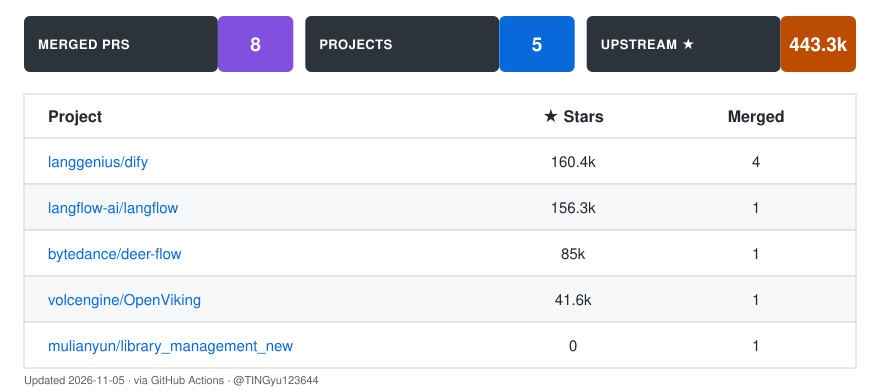

# TINGyu主人的贡献者仓库

### 在高星 AI / Agent 开源项目里，把 bug 修到上游

 

<table><tr>
<td align="center" width="55%">

</td>
<td align="center" width="45%">

</td>
</tr></table>

---

<!--START_SECTION:prs-->
## 🏆 已合并上游 PR（按仓库 star 数降序）

| # | 仓库 | PR | ⭐ Stars | 增 / 删 | 文件 | 含金量 |
|---|---|---|---|---|---|---|
| 1 | [**langgenius/dify**](https://github.com/langgenius/dify) | [#45261](https://github.com/langgenius/dify/pull/45261) — test(api): add unit tests for rag document models |  |  /  | 2 | 📌 merged |
| 2 | [**langgenius/dify**](https://github.com/langgenius/dify) | [#45255](https://github.com/langgenius/dify/pull/45255) — test(api): add unit tests for uuid_utils.is_valid_uuid |  |  /  | 1 | 🧪 测试基建 |
| 3 | [**langgenius/dify**](https://github.com/langgenius/dify) | [#45254](https://github.com/langgenius/dify/pull/45254) — test(api): add unit tests for remove_leading_symbols |  |  /  | 1 | 📌 merged |
| 4 | [**langgenius/dify**](https://github.com/langgenius/dify) | [#45225](https://github.com/langgenius/dify/pull/45225) — fix(libs): reject non-dict output in parse_and_check_json... |  |  /  | 2 | 📌 merged |
| 5 | [**langflow-ai/langflow**](https://github.com/langflow-ai/langflow) | [#15411](https://github.com/langflow-ai/langflow/pull/15411) — fix(schema): sanitize underscore-prefixed field names in ... |  |  /  | 4 | 🏆 核心功能修复 |
| 6 | [**bytedance/deer-flow**](https://github.com/bytedance/deer-flow) | [#6361](https://github.com/bytedance/deer-flow/pull/6361) — fix(tests): skip MAX_PATH-exceeding blocking-io anchors o... |  |  /  | 3 | 🪟 跨平台兼容 |
| 7 | [**volcengine/OpenViking**](https://github.com/volcengine/OpenViking) | [#6387](https://github.com/volcengine/OpenViking/pull/6387) — fix(compile): keep the compile workspace root absolute (#... |  |  /  | 2 | 🐛 真实 Bug |

### 📖 每条 PR 在修什么

#### 📌 [#45261](https://github.com/langgenius/dify/pull/45261) · [langgenius/dify](https://github.com/langgenius/dify) — test(api): add unit tests for rag document models
**合并者 maintainer · 2026-11-05 · +226 / −0 · 2 files**

---

#### 🧪 [#45255](https://github.com/langgenius/dify/pull/45255) · [langgenius/dify](https://github.com/langgenius/dify) — test(api): add unit tests for uuid_utils.is_valid_
**合并者 @wylswz · 2026-11-03 · +32 / −0 · 1 files**

- `api/core/tools/utils/uuid_utils.py` 的 `is_valid_uuid` 此前**零测试覆盖**（旧测试覆盖的是另一个 `libs/uuid_utils.py`）。
- 新增 11 个参数化用例：规范连字符、大写、无连字符、带花括号、`urn:uuid:` 前缀 → 全部接受；`None`、空串、普通词、长短一位、非十六进制字符 → 全部拒绝。
- 纯增量、不改生产代码；review 轮按 pyrefly `strict` preset 补了 `-> None` 返回类型标注。

---

#### 📌 [#45254](https://github.com/langgenius/dify/pull/45254) · [langgenius/dify](https://github.com/langgenius/dify) — test(api): add unit tests for remove_leading_symbo
**合并者 maintainer · 2026-11-04 · +59 / −0 · 1 files**

---

#### 📌 [#45225](https://github.com/langgenius/dify/pull/45225) · [langgenius/dify](https://github.com/langgenius/dify) — fix(libs): reject non-dict output in parse_and_che
**合并者 maintainer · 2026-11-05 · +19 / −0 · 2 files**

---

#### 🏆 [#15411](https://github.com/langflow-ai/langflow/pull/15411) · [langflow-ai/langflow](https://github.com/langflow-ai/langflow) — fix(schema): sanitize underscore-prefixed field na
**合并者 @erichare · 2026-09-28 · +264 / −11 · 4 files**

- JSON Schema 属性名允许以 `_` 开头（Glean 的 `chat`/`search` 工具就这么声明 `_user_goal`），但 Pydantic 把前导下划线字段当私有属性，`create_model()` 直接抛 `NameError`；`update_tools()` 又把这个异常吞掉继续——**用户看到的是 "Successfully loaded 0 tools"，全程无报错**。
- 修复：剥离前导下划线构造 Pydantic 安全字段名 → 确定性去重（不用 `hash()`，避免 `PYTHONHASHSEED` 随机化）→ 原 wire 名通过 `AliasChoices(safe, wire, camelCase)` 保留；嵌套循环与顶层循环都覆盖。
- 本地复现：Glean 式 schema 在旧 HEAD 必抛 `NameError`，修复后模型构建、按 `_user_goal` 校验、`model_dump()` 往返全部通过。

---

#### 🪟 [#6361](https://github.com/bytedance/deer-flow/pull/6361) · [bytedance/deer-flow](https://github.com/bytedance/deer-flow) — fix(tests): skip MAX_PATH-exceeding blocking-io an
**合并者 @WillemJiang · 2026-10-06 · +31 / −3 · 3 files**

- `backend/tests/blocking_io/` 下 12 个锚点在 Windows 上确定性地挂在 `OSError: [Errno 206] Filename or extension too long`，根本走不到被测逻辑——真实磁盘布局嵌套 + `tmp_path` 前缀突破了 260 字符 MAX_PATH。
- 给三个受影响文件加模块级 `pytest.mark.skipif(os.name == "nt")`，对齐项目已合并的 `#6257` / `#5931` 约定；POSIX 上照常跑，Windows CI 转绿。

---

#### 🐛 [#6387](https://github.com/volcengine/OpenViking/pull/6387) · [volcengine/OpenViking](https://github.com/volcengine/OpenViking) — fix(compile): keep the compile workspace root abso
**合并者 @fujiajie666 · 2026-10-21 · +39 / −2 · 2 files**

- Docker 部署里 `storage.workspace` 配成相对路径时，每个 `ov compile` 任务在 `stage=sandbox` 直接报 `mkdir: cannot create directory ... No such file or directory`。
- 根因：`CompileSandboxManager` 把相对工作区根传进沙箱后端，凭证路径被相对解析了**两次**。
- 修复：在唯一入口 `CompileSandboxManager.__init__` 里把根目录 `resolve()` 成绝对路径，并加回归测试（相对 workspace 下断言凭证路径为绝对路径）。

---

<!--END_SECTION:prs-->

---

<table><tr>
<td align="center" width="55%">

</td>
<td align="center" width="45%">

</td>
</tr></table>

---

自动刷新墙（GitHub Actions · 每小时刷新 star 数与 PR 列表）

🤖 由 TINGyu123644 维护 · 只记录真实合入上游的改动，未合并的不写成"已采用"

